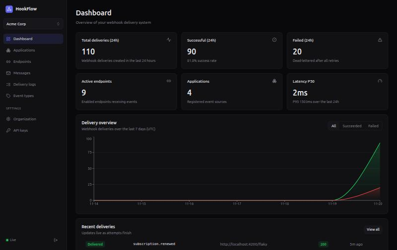
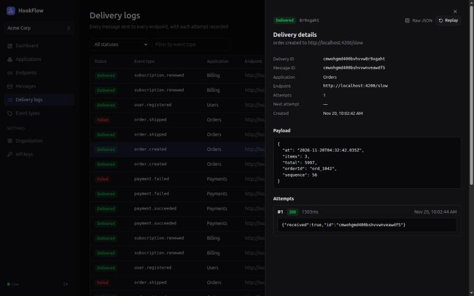
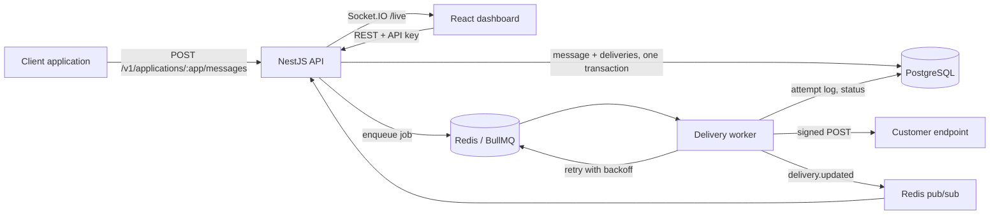
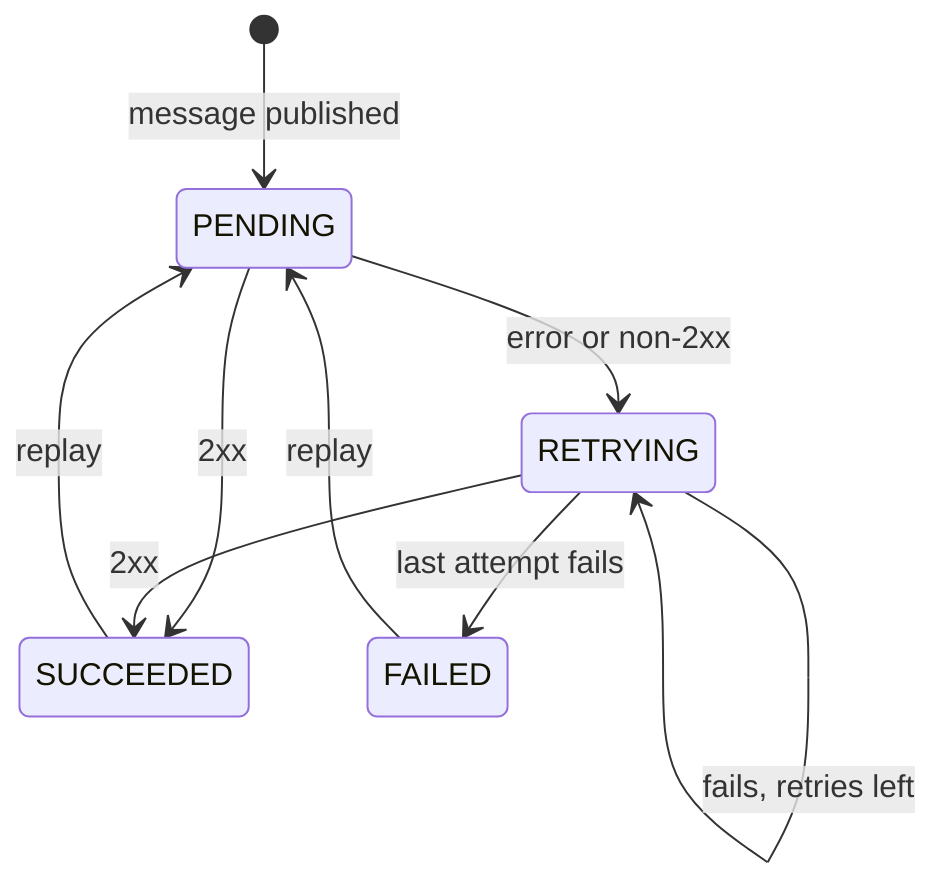

# HookFlow

**Webhook delivery and event management platform.** Your services publish an event once; HookFlow signs it, delivers it to every subscribed endpoint, retries with exponential backoff, dead-letters what keeps failing, and records every attempt so developers can see exactly what happened.

Built with **NestJS · TypeScript · PostgreSQL · Prisma · Redis · BullMQ · Socket.IO · React 19 · Docker**.



## The problem

A payment system captures a payment and has to tell other systems: *payment succeeded*, *order created*, *user registered*, *subscription renewed*. Sometimes the receiving server is down or slow. Someone has to retry, record the failures, keep a log developers can trust, and make sure a receiver can prove the request really came from you. HookFlow is that someone.

## Features

| Area | What it does |
| --- | --- |
| Multi-tenant API | Organizations with hashed API keys (`hf_live_…`). Every query is scoped to the caller's organization. |
| Applications and endpoints | Group endpoints by the system that sends events. Each endpoint can subscribe to all events or a list of event types. |
| Event type catalogue | Named events with descriptions and example payloads, used for endpoint filters. |
| Idempotent publishing | `Idempotency-Key` header or field: a repeat returns the original message (HTTP 200, `Idempotent-Replayed: true`), including under concurrent duplicates. |
| Transactional fan-out | The message and one delivery row per matching endpoint are written in one transaction, then queued. |
| Signed requests | [Standard Webhooks](https://www.standardwebhooks.com/) headers: `webhook-id`, `webhook-timestamp`, `webhook-signature` (HMAC-SHA256). Secrets can be revealed and rotated. |
| Retries and dead-lettering | Configurable schedule (default 5s, 30s, 2m, 10m, 30m) with ±20% jitter; after the last attempt the delivery is `FAILED`. |
| Replay | Replay one delivery or every failed delivery for an endpoint or application. Double clicks queue one attempt, not two. |
| Delivery logs | Every attempt keeps its status code, latency, error and response body (first 2 KB). |
| Live dashboard | Socket.IO pushes updates from any worker through Redis pub/sub; stats include 24h success rate and p50/p95 latency. |
| Separately scalable worker | `dist/worker.js` runs the BullMQ consumer without an HTTP server. A sweeper re-queues anything stuck between commit and enqueue. |
| Operations | Swagger at `/docs`, `/health` for PostgreSQL and Redis, structured pino logs with secrets redacted, Docker images, GitHub Actions CI. |



## Architecture



**Delivery lifecycle**



### Design decisions

- **The worker schedules its own retries.** Each attempt is a separate BullMQ job with a deterministic id (`<deliveryId>-<attempt>`) instead of BullMQ's built-in `attempts`. Every attempt is written to `DeliveryAttempt`, the delay comes from a configurable schedule, and enqueueing the same attempt twice is a no-op.
- **At-least-once, safe to repeat.** A job checks that the delivery's `attemptCount` is exactly one behind it before sending, and `(deliveryId, attempt)` is unique, so duplicate or stale jobs are dropped. Receivers deduplicate on `webhook-id`, which stays the same across retries.
- **The commit-then-enqueue gap.** If Redis is unavailable right after the database commit, the delivery stays `PENDING` and the sweeper re-queues it within a few minutes. A transactional outbox is on the roadmap.
- **Jitter.** ±20% on every delay keeps thousands of retries from landing on a recovering endpoint in the same second.
- **Secrets.** API keys are stored as SHA-256 hashes and shown once. Comparisons are constant-time. Endpoint secrets are returned only on creation, reveal or rotation.

## Quick start

### Everything in Docker

```bash
docker compose --profile app up --build
```

API on http://localhost:3200 (Swagger at `/docs`), dashboard on http://localhost:5180, demo receiver on http://localhost:4200. Then fill it with demo data:

```bash
RECEIVER_URL=http://receiver:4200 npm run demo
```

Paste the printed API key into the dashboard.

### Local development

Requires Node 22 and Docker.

```bash
npm install
npm run infra:up                 # PostgreSQL :5440, Redis :6390
cp apps/api/.env.example apps/api/.env
npm run db:migrate
npm run dev:api                  # API + in-process worker on :3200
npm run dev:receiver             # demo receiver on :4200
npm run dev:dashboard            # dashboard on :5180
npm run demo                     # Acme Corp demo organization; prints an API key
```

Set `RUN_WORKER_IN_API=false` and run `npm run dev:worker` to see the worker as its own process.

### The demo receiver

| Route | Behaviour |
| --- | --- |
| `/ok` | Always 200 |
| `/slow` | 200 after 1.5 s |
| `/flaky` | 503 for `FAIL_RATE` of requests (default 30%) |
| `/down` | Always 500 |
| `/status/:code` | Responds with that code, e.g. `/status/429` |

## Using the API

```bash
# Create an organization (returns the first API key, once)
curl -X POST localhost:3200/v1/organizations \
  -H 'x-admin-token: change-me-admin-token' -H 'content-type: application/json' \
  -d '{"name":"Acme"}'

# Register an application and an endpoint
curl -X POST localhost:3200/v1/applications -H "Authorization: Bearer $KEY" \
  -H 'content-type: application/json' -d '{"name":"Payments","uid":"payments"}'
curl -X POST localhost:3200/v1/endpoints -H "Authorization: Bearer $KEY" \
  -H 'content-type: application/json' \
  -d '{"applicationId":"payments","url":"http://localhost:4200/ok","filterTypes":["payment.succeeded"]}'

# Publish an event
curl -X POST localhost:3200/v1/applications/payments/messages -H "Authorization: Bearer $KEY" \
  -H 'content-type: application/json' -H 'Idempotency-Key: pay_9xK2' \
  -d '{"eventType":"payment.succeeded","payload":{"paymentId":"pay_9xK2","amount":2499}}'
```

| Method | Path | Purpose |
| --- | --- | --- |
| POST | `/v1/organizations` | Create an organization (`x-admin-token`) |
| GET, PATCH | `/v1/organization` | Current organization |
| GET, POST, DELETE | `/v1/api-keys` | List, create, revoke API keys |
| GET, POST, PATCH, DELETE | `/v1/applications[/:app]` | Applications (`:app` is the id or uid) |
| GET, POST, PATCH, DELETE | `/v1/event-types[/:id]` | Event type catalogue |
| GET, POST, PATCH, DELETE | `/v1/endpoints[/:id]` | Endpoints, filterable by `applicationId` |
| GET, POST | `/v1/endpoints/:id/secret`, `/rotate-secret`, `/test` | Reveal or rotate the secret, send a test event |
| POST | `/v1/applications/:app/messages` | Publish an event |
| GET | `/v1/messages[/:id]` | Messages and their deliveries (cursor pagination) |
| GET | `/v1/deliveries[/:id]` | Delivery log with attempts, filterable by status, endpoint, message, event type |
| POST | `/v1/deliveries/:id/replay`, `/v1/deliveries/replay-failed` | Replay one or many |
| GET | `/v1/stats`, `/v1/stats/daily` | 24h totals and latency, daily series |
| GET | `/health` | PostgreSQL and Redis readiness |

### Verifying a webhook

[`apps/receiver/verify.mjs`](apps/receiver/verify.mjs) is a dependency-free helper you can copy:

```js
import { verifyWebhook } from './verify.mjs';

if (!verifyWebhook(process.env.WEBHOOK_SECRET, req.headers, rawBody)) {
  return res.status(401).end();
}
```

It recomputes `base64(HMAC-SHA256(secret, "<webhook-id>.<webhook-timestamp>.<body>"))`, compares in constant time, and rejects timestamps older than five minutes.

## Tests

```bash
npm test                         # API unit tests (Jest) + receiver tests (node:test)
npm run test:e2e                 # full flow against real PostgreSQL and Redis
```

The end-to-end suite boots the API with an in-process worker and a local HTTP receiver, then checks signed delivery and filtering, retries to `FAILED`, replay, idempotency and stats. CI runs all of it plus the Docker builds on every push.

## Project layout

```
apps/
  api/          NestJS API and delivery worker (Prisma schema in prisma/)
  dashboard/    React + Vite dashboard
  receiver/     Demo receiver and signature verification helper
scripts/demo.mjs  Seeds a realistic workload
```

## Roadmap

- [ ] Circuit breaker: auto-disable an endpoint after N consecutive failed deliveries, with an email alert
- [ ] Transactional outbox in place of the commit-then-enqueue sweeper
- [ ] SSRF protection: block private and link-local addresses for production endpoints
- [ ] Per-endpoint rate limits and concurrency caps
- [ ] JSON Schema validation of payloads against event types
- [ ] Retention job for old messages and attempts
- [ ] Prometheus metrics and OpenTelemetry traces
- [ ] Dashboard users with email login and roles, alongside API keys
- [ ] Embeddable customer portal for managing their own endpoints

## License

MIT
